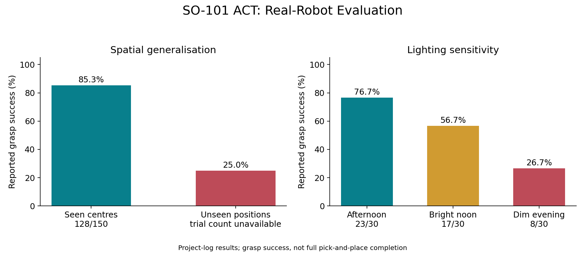
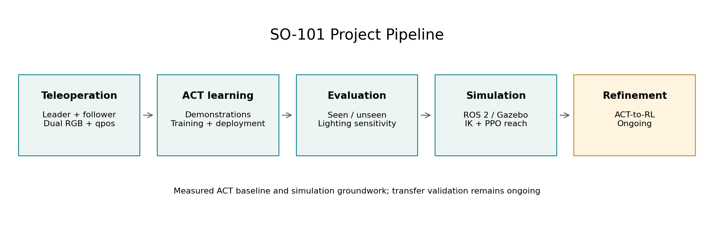
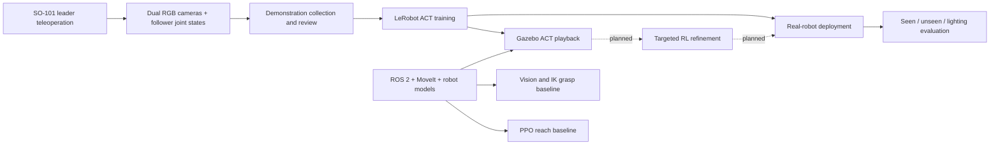
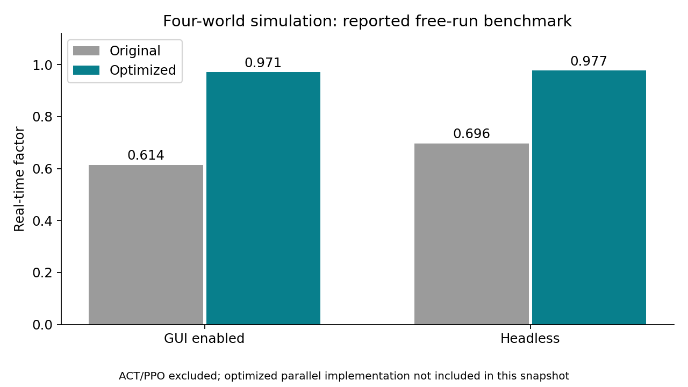

# SO-101 Learning-Based Manipulation

A low-cost robot manipulation project combining real-robot ACT imitation learning,
ROS 2 / Gazebo simulation, visual grasping, and reinforcement-learning groundwork.



**Reported real-robot grasp success:** 85.3% at demonstrated centres and 25.0% at
unseen positions. The gap motivates targeted policy refinement.

This repository is a curated publication draft. It includes source code and
reported experiment summaries; datasets, weights, build outputs and personal
project slides are excluded. ACT-to-PPO refinement and successful sim-to-real
transfer remain ongoing work.

## System





## Results and Scope

| Evaluation | Reported result | Interpretation |
|---|---:|---|
| Single-centre grasp | 9/10 | Fixed-position skill reproduction |
| Demonstrated 3 x 5 centres | 128/150 (85.3%) | 10 trials at each of 15 positions |
| Unseen positions | 25.0% | Trial count not supplied in the project log |
| Afternoon lighting | 23/30 (76.7%) | Closest to collection lighting |
| Bright noon lighting | 17/30 (56.7%) | Reduced visual robustness |
| Dim evening lighting | 8/30 (26.7%) | Larger deployment domain gap |

These are **grasp** metrics; they do not establish full pick-and-place completion.
Results are transcribed from the team project log, not regenerated by this draft.
See [experiment evidence](docs/experiments.md) for sample-size and provenance notes.



## Repository Map

| Directory | Purpose |
|---|---|
| `ros/src/` | Robot description, meshes and MoveIt configuration |
| `simulation/worlds/` | Tabletop scene, robot SDF/URDF and scene assets |
| `simulation/config/` | ROS controller settings |
| `control/` | Camera-based cube detection and MoveIt IK grasping |
| `learning/act/` | ACT playback, action logging and TensorBoard tools |
| `learning/ppo/` | Existing Gazebo PPO reach environment and train/play scripts |
| `evaluation/` | Fixed-camera dataset-view utility |
| `tools/` | Calibration, scene reset and real-to-sim pose tools |
| `assets/` | Reproducible result and system figures |
| `docs/` | Setup, evidence, source inventory and release review |

The PPO reach baseline is a separate experiment, not an implementation of ACT
warm-start PPO grasp refinement. The original machine-specific launcher was
excluded because it depended on a missing ROS workspace layout.

## Minimal Offline Run

```bash
python3 scripts/smoke_check.py
python3 scripts/test_act_workflow.py
```

This requires only Python's standard library. It compiles Python source in memory,
parses robot XML, checks mesh references and validates the reported-result fixture.
It does not connect to a robot or start Gazebo. For ROS build and runtime setup,
see [setup](docs/setup.md).

## ACT Workflow

The [ACT guide](docs/act_workflow.md) covers collection, dataset integrity checks,
training/resume, real-follower deployment, TensorBoard and trial-level evaluation.
Use `configs/act_workflow.json` for hardware paths and experiment settings.
`python learning/act/workflow.py --help` lists stages. Commands preview by default;
actual hardware/training operations require `--execute`.
The [environment snapshot](docs/environment.md) records the local LeRobot base
commit and modifications that affect reproducibility.

Chinese instructions: [ACT 快速使用说明](docs/act_quickstart_zh.md).

## Reproduce the Figures

```bash
python3 scripts/render_figures.py
```

Requires Matplotlib. Input values and their limitations are recorded in
`configs/reported_results.json`.

## Attribution

ACT and PPO use
existing learning libraries; robot/MoveIt assets include upstream or generated
material. See [third-party notices](THIRD_PARTY_NOTICES.md).

Robot mesh binaries are excluded from Git publication and must be obtained
separately for simulation. The [LeRobot reproduction guide](docs/lerobot_reproduction.md)
includes the local source patch and its verification limits. No open-source license is
asserted for the entire collection at this stage.
